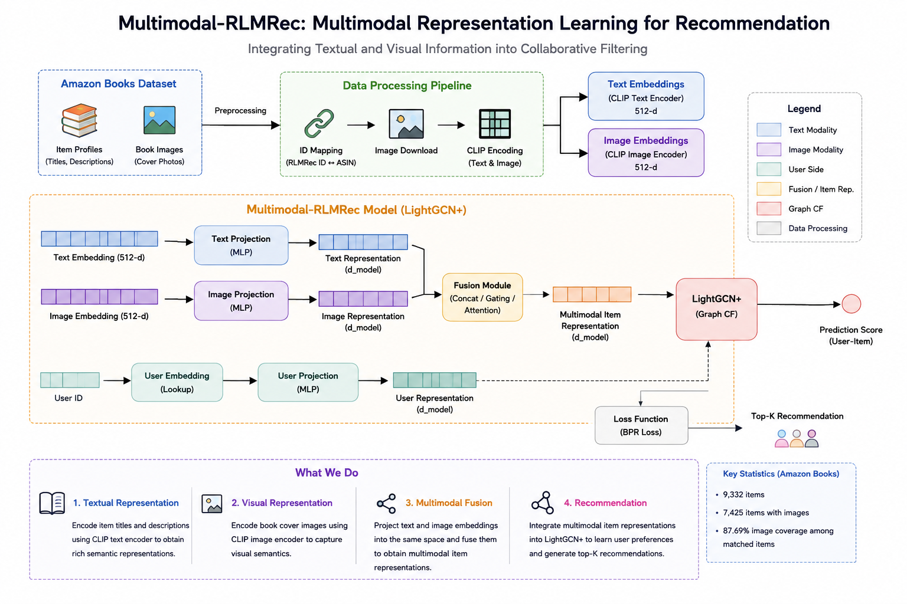

# Multimodal-RLMRec

### Multimodal Representation Learning for Recommendation

An extension of **RLMRec** that investigates how textual and visual item information can be integrated into collaborative filtering through multimodal representation learning.

**Final Year Project · Nanyang Technological University**

---

## Overview

Traditional collaborative filtering primarily relies on user-item interaction signals. However, items also contain rich semantic information in text and images that may complement collaborative representations.

This project extends the LightGCN-based RLMRec framework with multimodal item representations and investigates different strategies for combining textual and visual information.

The final system includes:

- **OpenAI text embeddings**
- **CLIP text embeddings**
- **CLIP image embeddings**
- **Modality-specific projection networks**
- **MLP fusion**
- **Adaptive gated fusion**
- **Modality-level attention fusion**
- **BPR recommendation objective**
- **InfoNCE-based semantic-collaborative alignment**
- Integration with the **LightGCN+** recommendation framework

### Architecture

<p align="center">
  
</p>

The primary proposed model uses:

```text
OpenAI Text Embedding (1536-D)
            │
            ▼
      Text Projection
            │
            ├──────────────┐
            │              │
            │              ▼
            │        Gated Fusion
            │              ▲
            │              │
            └──────────────┤
                           │
CLIP Image Embedding (512-D)
            │              │
            ▼              │
      Image Projection ────┘
                           │
                           ▼
              Multimodal Item Representation
                           │
                           ▼
              Semantic-Collaborative Alignment
                           │
                           ▼
                       LightGCN
```

Both text and image representations are projected into a **32-dimensional recommendation space** before fusion.

---

## Key Contributions

### 1. Multimodal Item Representation

The original recommendation framework is extended to incorporate both textual and visual item information.

The project evaluates three types of multimodal fusion:

- **MLP Fusion**
- **Gated Fusion**
- **Attention-Based Fusion**

This allows direct comparison between fixed nonlinear fusion and adaptive modality weighting.

### 2. Adaptive Gated Fusion

The primary multimodal model learns an item-specific gate:

```math
s_i = g_i t_i + (1-g_i)v_i
```

where:

- $t_i$ is the projected text representation
- $v_i$ is the projected image representation
- $g_i$ is the learned text weight
- $1-g_i$ is the learned image weight

The gate is learned jointly with the recommendation model.

### 3. Attention-Based Fusion

An additional modality-level attention mechanism independently scores the projected text and image representations:

```math
e_t = w^\top \tanh(W_t t_i + b_t)
```

```math
e_v = w^\top \tanh(W_v v_i + b_v)
```

The two modality scores are normalized using a softmax function:

```math
[\alpha_t, \alpha_v]
=
\mathrm{softmax}([e_t, e_v])
```

where $\alpha_t$ and $\alpha_v$ represent the attention weights assigned to the text and image modalities, respectively, and satisfy:

```math
\alpha_t + \alpha_v = 1
```

The final multimodal item representation is computed as:

```math
s_i = \alpha_t t_i + \alpha_v v_i
```

This provides an additional adaptive fusion baseline for comparison with gated fusion.

### 4. Semantic-Collaborative Alignment

The multimodal semantic representations are aligned with collaborative representations using an InfoNCE-based objective.

The overall training objective combines:

```text
BPR Recommendation Loss
        +
Regularization
        +
InfoNCE Semantic Alignment
```

---

## Dataset

Experiments are conducted on a processed subset of the **Amazon Books** dataset derived from the RLMRec data.

### Dataset Construction

The original item set contains:

| Statistic | Value |
|---|---:|
| Original items | 9,332 |
| Items matched with Amazon metadata | 8,467 |
| Metadata matching rate | 90.7% |
| Items with usable cover images | 7,425 |

The final multimodal dataset is:

| Statistic | Value |
|---|---:|
| Dataset | `amazon7425` |
| Users | 10,989 |
| Items | 7,425 |
| Valid text embeddings | 7,425 / 7,425 |
| Valid image embeddings | 7,425 / 7,425 |

All final experiments use the same `amazon7425` dataset to ensure fair comparison between unimodal and multimodal models.

---

## Multimodal Data Pipeline

### 1. Item Mapping

RLMRec item IDs are mapped to Amazon metadata and ASINs.

```text
RLMRec Item ID
      │
      ▼
Amazon Metadata
      │
      ▼
ASIN / Image URL
```

Implemented in:

```text
scripts/build_image_mapping.py
```

### 2. Image Collection

Book cover images are downloaded and associated with the corresponding recommendation item IDs.

Implemented in:

```text
generation/image/download_images.py
```

The final dataset contains valid cover images for all **7,425 items** used in multimodal experiments.

### 3. Semantic Representation

Three semantic representations are used in the experiments:

```text
CLIP Text Embedding   : 512-D
CLIP Image Embedding  : 512-D
OpenAI Text Embedding : 1536-D
```

Relevant encoding scripts include:

```text
generation/text/encode_text.py
generation/image/encode_image.py
```

### 4. Projection

Each modality is independently projected into the common recommendation embedding space:

```text
Semantic Embedding
       │
       ▼
Projection MLP
       │
       ▼
32-D Representation
```

### 5. Multimodal Fusion

Projected text and image representations are combined using one of:

```text
MLP Fusion
Gated Fusion
Attention Fusion
```

The resulting semantic item representation is then aligned with the collaborative item representation learned by LightGCN.

---

## Model Architecture

### Collaborative Recommendation Backbone

The recommendation backbone follows LightGCN-style graph propagation over user-item interactions.

```text
User / Item ID Embeddings
          │
          ▼
   LightGCN Propagation
          │
          ▼
Collaborative Representations
```

### Semantic Side

```text
User Semantic Profile
        │
        ▼
User Projection
        │
        ▼
Semantic User Representation
```

For items:

```text
Text Representation ──► Text Projection ──┐
                                          │
                                          ▼
                                      Fusion
                                          ▲
                                          │
Image Representation ─► Image Projection ─┘
                                          │
                                          ▼
                              Semantic Item Representation
```

The semantic and collaborative representations are aligned through the contrastive learning objective.

---

## Fusion Modules

### MLP Fusion

Text and image features are concatenated and transformed using a feed-forward fusion network.

Implementation:

```text
encoder/models/modules/fusion.py
```

### Gated Fusion

A learned gate determines the relative contribution of text and image features for each item.

Implementation:

```text
encoder/models/modules/gated_fusion.py
```

### Attention Fusion

Text and image modalities independently receive attention scores, which are normalized using softmax.

Implementation:

```text
encoder/models/modules/attention_fusion.py
```

---

## Experimental Setup

All final experiments use the same training configuration unless otherwise stated.

```text
Dataset            : amazon7425
Embedding size     : 32
LightGCN layers    : 3
Batch size         : 4096
Optimizer          : Adam
Learning rate      : 0.001
Keep rate          : 0.8
KD weight          : 0.01
KD temperature     : 0.2
Early stopping     : patience = 5
Evaluation K       : 5, 10, 20
```

To reduce sensitivity to random initialization, every final model is evaluated using three random seeds:

```text
2023
2024
2025
```

Results are reported as:

```text
mean ± sample standard deviation
```

---

## Experimental Results

### Recommendation Performance

| Model | Recall@5 | Recall@10 | Recall@20 | NDCG@5 | NDCG@10 | NDCG@20 |
|---|---:|---:|---:|---:|---:|---:|
| LightGCN | 0.06442 ± 0.00062 | 0.10180 ± 0.00010 | 0.15376 ± 0.00145 | 0.06078 ± 0.00050 | 0.07385 ± 0.00035 | 0.09052 ± 0.00043 |
| LightGCN+ / OpenAI Text | 0.06650 ± 0.00037 | 0.10738 ± 0.00040 | 0.16125 ± 0.00064 | 0.06156 ± 0.00059 | 0.07609 ± 0.00072 | 0.09335 ± 0.00050 |
| CLIP Text | 0.06618 ± 0.00108 | 0.10483 ± 0.00139 | 0.15826 ± 0.00231 | 0.06147 ± 0.00102 | 0.07534 ± 0.00120 | 0.09242 ± 0.00161 |
| CLIP Image | 0.06884 ± 0.00023 | 0.10812 ± 0.00113 | 0.16143 ± 0.00281 | 0.06341 ± 0.00063 | 0.07736 ± 0.00066 | 0.09439 ± 0.00104 |
| CLIP Text + Image (MLP) | 0.06519 ± 0.00206 | 0.10389 ± 0.00260 | 0.15778 ± 0.00244 | 0.06036 ± 0.00155 | 0.07407 ± 0.00181 | 0.09120 ± 0.00201 |
| CLIP Text + Image (Gated) | 0.06908 ± 0.00248 | 0.10764 ± 0.00277 | 0.16298 ± 0.00217 | 0.06371 ± 0.00121 | 0.07756 ± 0.00127 | 0.09526 ± 0.00119 |
| OpenAI Text + CLIP Image (MLP) | 0.06636 ± 0.00295 | 0.10575 ± 0.00095 | 0.15929 ± 0.00078 | 0.06140 ± 0.00193 | 0.07551 ± 0.00106 | 0.09267 ± 0.00077 |
| **OpenAI Text + CLIP Image (Gated)** | **0.06979 ± 0.00170** | 0.10913 ± 0.00082 | 0.16478 ± 0.00095 | **0.06523 ± 0.00100** | **0.07924 ± 0.00058** | **0.09698 ± 0.00055** |
| OpenAI Text + CLIP Image (Attention) | 0.06938 ± 0.00156 | **0.11079 ± 0.00162** | **0.16508 ± 0.00168** | 0.06435 ± 0.00107 | 0.07919 ± 0.00096 | 0.09659 ± 0.00105 |

### Main Observations

The multimodal experiments show that adaptive fusion is beneficial compared with fixed MLP fusion.

For OpenAI text and CLIP image representations:

```text
MLP
R@20 = 0.15929
N@20 = 0.09267

Gated
R@20 = 0.16478
N@20 = 0.09698

Attention
R@20 = 0.16508
N@20 = 0.09659
```

Compared with MLP fusion, gated fusion improves:

```text
Recall@20 ≈ +3.45%
NDCG@20   ≈ +4.65%
```

Attention fusion similarly improves over MLP fusion:

```text
Recall@20 ≈ +3.63%
NDCG@20   ≈ +4.24%
```

The attention model achieves the highest **Recall@10** and **Recall@20**, while the gated model achieves the highest **Recall@5** and all three **NDCG** metrics.

Overall, both adaptive fusion strategies consistently outperform the corresponding MLP fusion model.

---

## Analysis of Learned Modality Weights

The primary gated model was further analyzed to understand how it combines text and visual information.

The analysis uses the average learned gate weights across all three random seeds.

### Overall Modality Preference

```text
Mean text weight  : 0.72893
Mean image weight : 0.27107
```

The model generally places greater weight on text representations, while still assigning meaningful weight to visual information.

### Cross-Seed Stability

Pairwise Spearman correlations between item-level gate weights are:

```text
2023 vs 2024 : 0.573
2023 vs 2025 : 0.635
2024 vs 2025 : 0.695
```

The mean per-item gate standard deviation is:

```text
0.01373
```

This suggests that the overall modality preference is relatively stable, although fine-grained item rankings remain sensitive to initialization.

---

## Genre Analysis

Items are associated with 12 multi-label genre categories.

Examples of mean image weights include:

```text
Romance            : 0.27749
Young Adult        : 0.27215
Fantasy            : 0.27090
Mystery / Thriller : 0.27052
Biography / Memoir : 0.26007
Children           : 0.26039
```

Among the 50 items with the highest image weights:

```text
Romance            : 64%
Mystery / Thriller : 26%
```

Among the 50 items with the lowest image weights:

```text
Historical              : 26%
Religion / Spirituality : 24%
Biography / Memoir      : 14%
```

Genre indicators alone explain approximately:

```text
R² = 0.208
```

of the variation in learned image weights.

---

## Text-Image Semantic Similarity

Raw CLIP text-image similarity was compared against learned image weights.

The correlations are:

```text
Pearson  r   = 0.0106
Spearman rho = 0.0121
```

The relationship is negligible.

This suggests that simple text-image semantic similarity does not meaningfully explain how the gated model allocates modality weights.

---

## Visual Distinctiveness

Visual distinctiveness is defined using the average cosine similarity to the ten nearest image neighbors:

\[
D_i =
1 -
\frac{1}{10}
\sum_{j \in NN_{10}(i)}
\cos(v_i,v_j)
\]

The relationship between visual distinctiveness and learned image weight is:

```text
Pearson  r   = -0.207
Spearman rho = -0.226
```

Higher image weights are therefore associated with covers that are **less visually distinctive** and more consistent with recurring visual patterns.

The relationship remains negative within all 12 genre groups.

A regression controlling for genre gives:

```text
Genre only:
R² = 0.2085

Genre + visual distinctiveness:
R² = 0.2237

Incremental ΔR²:
0.0153
```

The standardized coefficient of visual distinctiveness is:

```text
β = -0.132
```

These results suggest that visual distinctiveness provides a modest but independent association with learned modality allocation beyond genre composition.

---

## Qualitative Findings

Manual inspection of items with relatively high image weights shows frequent:

- Faces
- Couples
- Human interactions
- Romance-oriented imagery
- Repeated genre-specific visual conventions

Items with relatively low image weights more frequently contain:

- Typography-heavy designs
- Historical or biographical covers
- Religious imagery
- Symbols and objects
- Informational or traditional illustrations

Together with the quantitative analysis, this suggests that the model may benefit from **recognizable and recurring visual patterns rather than visual novelty or simple text-image semantic redundancy**.

---

## Repository Structure

```text
Multimodal-RLMRec/
│
├── encoder/
│   ├── config/
│   │   └── modelconf/
│   │       ├── lightgcn_plus_gated_openai_clip_image.yml
│   │       └── lightgcn_plus_attention_openai_clip_image.yml
│   │
│   ├── models/
│   │   ├── general_cf/
│   │   │   ├── lightgcn_plus_openai_image.py
│   │   │   ├── lightgcn_plus_gated_openai_clip_image.py
│   │   │   └── lightgcn_plus_attention_openai_clip_image.py
│   │   │
│   │   └── modules/
│   │       ├── projection.py
│   │       ├── fusion.py
│   │       ├── gated_fusion.py
│   │       └── attention_fusion.py
│   │
│   └── ...
│
├── generation/
│   ├── image/
│   │   ├── download_images.py
│   │   └── encode_image.py
│   │
│   └── text/
│       └── encode_text.py
│
├── scripts/
│   └── build_image_mapping.py
│
├── tools/
│   └── build_amazon7425.py
│
├── assets/
│   └── multimodal_pipeline.png
│
├── data/
│   └── ...
│
├── .gitignore
└── README.md
```

Large datasets, downloaded images, generated embeddings, model checkpoints, and local environments are intentionally excluded from the repository.

---

## Getting Started

### Environment

The project was developed using:

- Python 3.9
- PyTorch 2.0
- CUDA 11.8
- NumPy 1.24.3
- SciPy 1.10.1
- CLIP

A CUDA-enabled GPU is recommended for embedding generation and model training.

### Clone the Repository

```bash
git clone <YOUR_REPOSITORY>
cd Multimodal-RLMRec
```

### Data Preparation

Large-scale datasets, downloaded images, and generated embeddings are not included in the repository.

After obtaining the required data, the preprocessing pipeline can be run using the provided scripts.

### Build Image Mapping

```bash
python scripts/build_image_mapping.py
```

### Download Images

```bash
python generation/image/download_images.py
```

### Generate Image Embeddings

```bash
python generation/image/encode_image.py
```

### Generate Text Embeddings

```bash
python generation/text/encode_text.py
```

---

## Training

### Gated Fusion Model

```bash
python encoder/train_encoder.py \
  --model lightgcn_plus_gated_openai_clip_image \
  --dataset amazon7425 \
  --cuda 0
```

### Attention Fusion Model

```bash
python encoder/train_encoder.py \
  --model lightgcn_plus_attention_openai_clip_image \
  --dataset amazon7425 \
  --cuda 0
```

The random seed can be changed in the corresponding model configuration file.

Final experiments use:

```text
2023
2024
2025
```

---

## Project Status

### Completed

- [x] Reproduced the LightGCN recommendation baseline
- [x] Reproduced the RLMRec / LightGCN+ semantic baseline
- [x] Processed the Amazon Books dataset
- [x] Matched recommendation items with Amazon metadata
- [x] Built complete image mappings for the final multimodal dataset
- [x] Generated CLIP text embeddings
- [x] Generated CLIP image embeddings
- [x] Generated OpenAI text embeddings
- [x] Implemented modality-specific projection networks
- [x] Implemented MLP multimodal fusion
- [x] Implemented adaptive gated fusion
- [x] Implemented modality-level attention fusion
- [x] Integrated multimodal representations into LightGCN+
- [x] Evaluated all final models across three random seeds
- [x] Conducted gate-weight analysis
- [x] Conducted genre analysis
- [x] Conducted text-image similarity analysis
- [x] Conducted visual-distinctiveness analysis
- [x] Conducted genre-controlled regression

### Current Stage

The model development and main experimental evaluation are complete.

Current work focuses on:

- Final report preparation
- Experimental interpretation
- Documentation and result visualization

---

## Relationship to RLMRec

This project is based on the original **RLMRec: Representation Learning with Large Language Models for Recommendation** framework.

The original framework provides semantic representation learning and the LightGCN-based recommendation pipeline.

This project extends the framework with:

```text
Original RLMRec
      │
      ▼
Text Semantic Representation
      │
      ▼
Semantic-Collaborative Alignment
      │
      ▼
LightGCN Recommendation


Multimodal-RLMRec
      │
      ├── OpenAI / CLIP Text Representation
      │
      ├── CLIP Image Representation
      │
      ├── Modality-Specific Projection
      │
      ├── MLP Fusion
      │
      ├── Gated Fusion
      │
      └── Attention Fusion
               │
               ▼
      Multimodal Semantic Representation
               │
               ▼
      Semantic-Collaborative Alignment
               │
               ▼
         LightGCN Recommendation
```

The original RLMRec implementation and research framework were developed by the RLMRec authors.

---

## Future Work

Possible extensions include:

- Evaluation on additional recommendation datasets
- Statistical significance testing across experimental configurations
- More detailed cold-start analysis
- User-conditioned multimodal fusion
- Investigation of modality importance across different recommendation domains
- More expressive attention architectures
- Analysis of how item popularity interacts with modality weighting

---

## Acknowledgements

This project is based on:

**RLMRec: Representation Learning with Large Language Models for Recommendation**

The original implementation is provided by the RLMRec authors.

This repository contains modifications and multimodal extensions developed as part of a Final Year Project at Nanyang Technological University.

---

## Author

**Shu Xuanyu**

Final Year Project  
Nanyang Technological University

**Research Interests:**  
Recommender Systems · Multimodal Learning · Large Language Models · Computer Vision · Machine Learning
